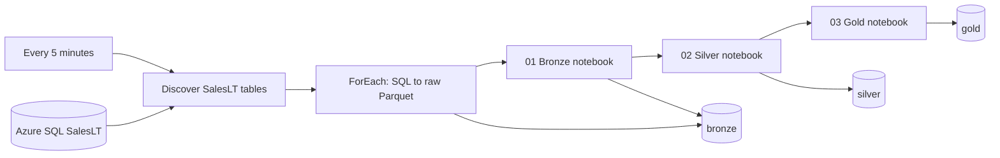

# SalesLT medallion pipeline — complete deployment guide

## Resources

| Component | Deployed resource |
|---|---|
| Subscription | Azure subscription 1 |
| SQL resource group | `keystoneade3` |
| SQL server | `keystoneade3sqlsrvr.database.windows.net` |
| SQL database and schema | `keystonesqldb1`, `SalesLT` |
| Processing resource group | `AMIT_Azure_retail` |
| Data Factory | `shortkart-retail-1520` |
| Pipeline | `pl_saleslt_medallion` |
| Databricks | `azuredatabricks_retail_sales` |
| Workspace | https://adb-7405619275354638.18.azuredatabricks.net |
| Cluster | `saleslt-medallion-adf` |
| Compute | Single node, `Standard_D4ds_v4`, zero workers, `19.x-scala2.13` |
| Storage | `adlsgenvs5`, ADLS Gen2 / Azure Blob Storage |
| Containers | `bronze`, `silver`, `gold`, all private |
| Trigger | `tr_saleslt_every_5_minutes` |

## Architecture



Data Factory dynamically discovers SalesLT base tables and primary keys. Four Copy activities can execute concurrently. XML columns are cast to strings for Parquet compatibility. Extraction is followed by **three separate notebook activities**, each requiring its predecessor to succeed:

| Activity | Workspace notebook |
|---|---|
| `Bronze_Notebook` | `/Shared/SalesLT_Medallion/01_bronze` |
| `Silver_Notebook` | `/Shared/SalesLT_Medallion/02_silver` |
| `Gold_Notebook` | `/Shared/SalesLT_Medallion/03_gold` |

The notebooks reuse one dedicated cluster assigned to Data Factory's service principal. The pipeline passes its run ID to all notebooks, and the discovered table metadata to Bronze. Each notebook displays sample records and returns a JSON manifest in its activity output.

## Source and sample installation

The user approved loading Microsoft's AdventureWorksLT sample because the selected database contained only `dbo.departments`. That table was preserved. Only SalesLT is processed by this pipeline.

The [official training script](https://github.com/MicrosoftLearning/dp-080-Transact-SQL/blob/95e42b8671fe63b2942ef59d5fc1db5b0c0c4edd/Scripts/adventureworkslt.sql) is downloaded from a pinned revision by `load_sample.py`. The loader skips database creation, `USE`, and database-setting statements, executes the remaining setup in a transaction against the existing database, and refuses to replace populated SalesLT tables. The downloaded script and sample data are excluded from Git.

| SalesLT table | Initial rows |
|---|---:|
| Address | 450 |
| Customer | 847 |
| CustomerAddress | 417 |
| Product | 295 |
| ProductCategory | 41 |
| ProductDescription | 762 |
| ProductModel | 128 |
| ProductModelProductDescription | 762 |
| SalesOrderDetail | 542 |
| SalesOrderHeader | 32 |
| **Total** | **4,276** |

## Layer transformations and paths

Paths are relative to `https://adlsgenvs5.blob.core.windows.net/`. `<run_id>` is the Data Factory pipeline run ID. This is a **full-snapshot** pipeline, with immutable run folders rather than incremental updates.

| Output | Path | Format |
|---|---|---|
| Raw SQL extract | `bronze/saleslt/raw/<run_id>/<Table>/` | Parquet |
| Bronze tables | `bronze/saleslt/snapshots/<run_id>/<Table>/` | Delta |
| Bronze manifest | `bronze/saleslt/manifests/<run_id>.json` | JSON |
| Silver tables | `silver/saleslt/snapshots/<run_id>/<Table>/` | Delta |
| Rejected Silver records | `silver/saleslt/quarantine/<run_id>/<Table>/` | Delta |
| Silver manifest | `silver/saleslt/manifests/<run_id>.json` | JSON |
| Gold datasets | `gold/saleslt/snapshots/<run_id>/<Dataset>/` | Delta |
| Gold exports | `gold/saleslt/exports/<run_id>/<Dataset>/` | Parquet |
| Gold manifest | `gold/saleslt/manifests/<run_id>.json` | JSON |
| Published run pointer | `gold/saleslt/latest_successful_run.json` | JSON |

**Bronze:** preserves source values and adds ingestion timestamp, source table, and pipeline run ID. It counts the Delta data after writing and emits a manifest.

**Silver:** trims strings and maps empty strings to null. It quarantines null primary keys, negative values in supported numeric fields, and discounts outside 0–1. It deduplicates by primary key, choosing the latest ModifiedDate with a deterministic row-hash tie breaker. Tables without key metadata are deduplicated across business columns. It records input, output, rejected, and duplicate counts and asserts that they reconcile.

**Gold:** validates the detail-to-order, detail-to-product, and order-to-customer relationships. It builds the datasets below, checks fact row counts against Silver, and reconciles fact net sales to the daily summary. It exports both Delta and plain Parquet. Only after all writes and validations pass does it update the latest-successful-run pointer.

| Gold dataset | Grain and measures |
|---|---|
| `dim_customer` | Customer attributes; excludes password fields |
| `dim_product` | Product with category, parent category, and model |
| `dim_date` | Observed order dates with year, quarter, month, day |
| `fact_sales` | Order-line grain; units, gross sales, discount, net sales |
| `fact_order` | Order grain; subtotal, tax, freight, total due |
| `sales_by_day` | Orders, customers, units, gross sales, discounts, net sales by date |
| `sales_by_product` | Orders, units, net sales by product/category |
| `sales_by_customer` | Orders, units, net sales by customer |

Net sales uses source `LineTotal` and excludes order tax and freight. Order-level amounts remain in `fact_order` to avoid duplication across lines. Bronze and Silver retain the complete source schema, including sample Customer password fields; Gold omits these fields.

Readers should resolve `latest_successful_run.json`, then read that run's paths. Delta readers must use the Delta format and its transaction log. Use `gold/.../exports/` for plain Parquet readers. Prior snapshots are preserved if a new run fails. There is no automatic snapshot retention policy; storage accumulates over time.

## Security configuration

- Your signed-in Azure account was configured as Microsoft Entra administrator for the Keystone SQL server, as explicitly requested.
- The factory's system-assigned managed identity authenticates to SQL and Databricks. No SQL password or Databricks PAT is stored in code.
- SQL user `shortkart-retail-1520` has `SELECT` on the SalesLT schema. Service-principal SQL SIDs use the application/client ID.
- The factory identity has Contributor access scoped to the Databricks workspace, required by this integration, and `CAN_RESTART` on its dedicated cluster.
- Databricks scope `saleslt-medallion` stores secret `storage-key`. The factory principal has READ access to the scope. This is a storage account key with account-wide access; rotate the scope secret when rotating the key.
- ADF extraction uses existing storage linked service `ls_shopkart_adls_gen2`. Its encrypted credential remains inside Azure and is not exported to Git.
- Layer containers are private. Existing Azure-services SQL firewall access was retained. The single-IP `CodexMedallionSetup` rules used for setup are removed after validation.

## Five-minute trigger

The native ADF schedule uses `frequency: Minute`, `interval: 5`, and a UTC start time. This gives the same five-minute cadence in India Standard Time. The exact start time and actual verification evidence are recorded in [docs/VALIDATION.md](docs/VALIDATION.md).

Pipeline concurrency is **one** to prevent overlapping publications. A run is requested every five minutes; this does not guarantee completion within five minutes. Runs queue if execution is slower. The first run includes cold cluster startup; subsequent runs reuse warm compute. Monitor the queue and adjust compute or cadence if it grows.

The cluster auto-terminates after **15 idle minutes**. A five-minute schedule normally keeps it active and billable. Azure VM, Databricks, Data Factory copy/activity, SQL, and snapshot storage charges continue while this schedule is active. Stopping the trigger does not cancel an existing run; the cluster terminates after becoming idle.

```powershell
python configure_trigger.py status
python configure_trigger.py stop
python configure_trigger.py start
python check_medallion.py
```

`start` requires the manually tracked validation run to have succeeded. Each start recreates the recurrence start time a minute into the future. In ADF Studio, use Author → Pipelines → `pl_saleslt_medallion`, Manage → Triggers, and Monitor → Pipeline runs / Trigger runs. Each notebook activity's output links to its Databricks run.

## Browse all layers

Run in Databricks as an authorized principal:

```python
import json
account = 'adlsgenvs5'
spark.conf.set(f'fs.azure.account.key.{account}.dfs.core.windows.net',
    dbutils.secrets.get('saleslt-medallion','storage-key'))
gold = f'abfss://gold@{account}.dfs.core.windows.net/saleslt'
run = json.loads(dbutils.fs.head(gold+'/latest_successful_run.json'))['run_id']
display(spark.read.format('delta').load(gold+f'/snapshots/{run}/sales_by_product'))
for layer in ['bronze','silver']:
    display(spark.read.format('delta').load(
        f'abfss://{layer}@{account}.dfs.core.windows.net/saleslt/snapshots/{run}/Customer'))
```

## Codebase and deployment

| File/folder | Purpose |
|---|---|
| `notebooks/` | Three notebook sources |
| `adf/` | Linked services, datasets, pipeline, trigger definitions |
| `azure_ops.py` | Azure CLI tokens and REST helpers |
| `load_sample.py` | One-time transactional source setup |
| `setup_access.ps1` | Explicit Entra administrator, temporary client IP rule, and workspace role setup |
| `cleanup_setup_access.ps1` | Remove temporary client IP rules after setup |
| `deploy_medallion.py` | SQL permissions, containers, secret, notebooks, ADF assets |
| `configure_shared_compute.py` | Reuse/create shared cluster, attach pipeline, start validation |
| `configure_trigger.py` | Start/stop/status of recurring schedule |
| `check_medallion.py` | Inspect manually tracked run and activity outputs |
| `verify_results.py` | Verify storage manifests and export Gold samples |
| `docs/VALIDATION.md` | Actual run results |
| `docs/results.json` | Machine-readable evidence |

Prerequisites: Azure CLI authenticated to this subscription, Python 3.12, network access to SQL, Azure resource management and SQL data permissions. Resource IDs/names are specific to this deployment; change them before using another environment. The existing ADF managed-identity Databricks linked service and ADLS storage linked service are prerequisites from the earlier demo setup.

```powershell
az login
pip install -r requirements.txt
# For a new deployment, review the account/resource names first:
./setup_access.ps1
# Only once, when SalesLT is not already populated:
python load_sample.py
python deploy_medallion.py
python configure_shared_compute.py
# Wait until the pipeline succeeds:
python check_medallion.py
python verify_results.py
python configure_trigger.py start
./cleanup_setup_access.ps1
```

Stop the trigger before redeployment. `deploy_medallion.py` initially attaches the earlier job-compute linked service; the compute configuration then attaches shared compute and starts a run. Reconfiguring compute can cancel the manually tracked prior validation run before starting a fresh run. Failed runs should be retried as new pipeline runs; run-specific Delta writes refuse to overwrite an existing snapshot.

Limitations: no CDC, incremental watermark, SCD type 2, Unity Catalog registration, configured alert destination, automated retention, or transactionally consistent snapshot spanning all SQL tables. Source changes during parallel extraction can create cross-table differences; validation rejects supported relationship/count failures. Validate sustained warm-run throughput before depending on a five-minute production SLA.

The earlier demo `pl_run_adb_notebook` and its local files remain available separately.

## References

- [Microsoft sample source](https://github.com/MicrosoftLearning/dp-080-Transact-SQL/blob/95e42b8671fe63b2942ef59d5fc1db5b0c0c4edd/Scripts/adventureworkslt.sql)
- [Databricks notebook activity](https://learn.microsoft.com/en-us/azure/data-factory/transform-data-using-databricks-notebook)
- [Compute linked services](https://learn.microsoft.com/en-us/azure/data-factory/compute-linked-services)
- [CREATE USER service principal SID](https://learn.microsoft.com/en-us/sql/t-sql/statements/create-user-transact-sql?view=sql-server-ver17)
- [Databricks secrets](https://learn.microsoft.com/en-us/azure/databricks/security/secrets/)
